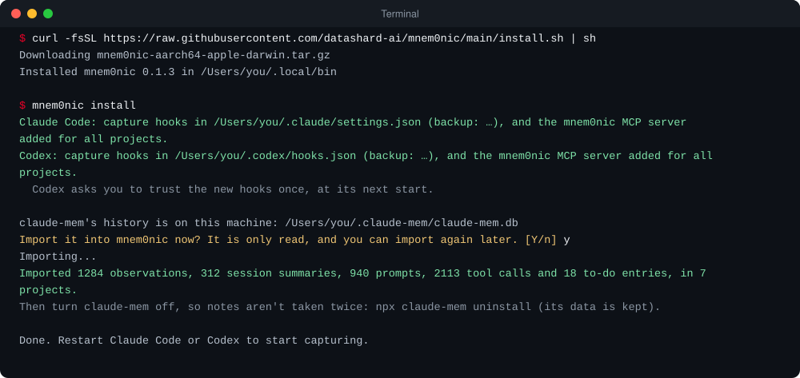
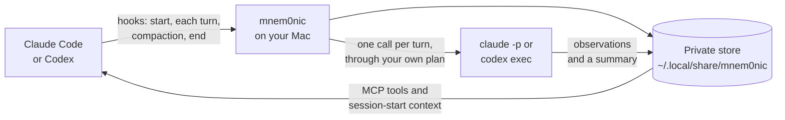

<h1 align="center">
  <br>
  <a href="https://github.com/datashard-ai/mnem0nic">
    <picture>
      <source media="(prefers-color-scheme: dark)" srcset="assets/logo-dark.png">
      <source media="(prefers-color-scheme: light)" srcset="assets/logo-light.png">
      
    </picture>
  </a>
</h1>

<h4 align="center">Persistent memory for <a href="https://claude.com/claude-code">Claude Code</a> and <a href="https://developers.openai.com/codex/cli">Codex</a>. Local, one binary, on the plan you already pay for.</h4>

<p align="center">
  <a href="https://github.com/datashard-ai/mnem0nic/releases/latest"></a>
  
  
  
  <a href="LICENSE.md"></a>
</p>

<p align="center">
  
</p>

<p align="center">
  <a href="#quick-start">Quick Start</a> •
  <a href="#key-features">Key Features</a> •
  <a href="#moving-from-claude-mem">Moving from claude-mem</a> •
  <a href="#how-it-works">How It Works</a> •
  <a href="#syncing-your-macs">Syncing Your Macs</a> •
  <a href="#running-as-a-memory-service">Memory Service</a> •
  <a href="#mcp-tools">MCP Tools</a> •
  <a href="#privacy">Privacy</a> •
  <a href="#keeping-things-out">Keeping Things Out</a> •
  <a href="#redaction">Redaction</a> •
  <a href="#configuration">Configuration</a> •
  <a href="#troubleshooting">Troubleshooting</a>
</p>

<p align="center">
  mnem0nic records your coding sessions on your own Mac, writes a short note after every turn, and gives
  your agent tools to search and pick up past work, across projects and across both CLIs.
</p>

---

## Quick Start

```sh
curl -fsSL https://raw.githubusercontent.com/datashard-ai/mnem0nic/main/install.sh | sh
mnem0nic install
```

Then restart Claude Code or Codex. That's it.

- The first command downloads the latest release, checks its SHA-256 checksum and puts `mnem0nic`
  in `~/.local/bin`.
- The second sets mnem0nic up for all your projects, in each CLI signed in with its own paid plan,
  after a dated backup of each settings file it changes, and downloads the search model (130 MB, once)
  for search by meaning.
- **Coming from claude-mem?** `mnem0nic install` finds your claude-mem history and offers to import
  it. Press Enter.

**Requirements:** a Mac with Apple silicon (for Linux, see Platforms below), and at least one of:

- **Claude Code**, signed in with a paid Claude plan (Pro, Max, Team or Enterprise);
- **Codex**, signed in with a paid ChatGPT plan (Plus, Pro, Business, Enterprise or Edu).

Running mnem0nic as a [memory service](#running-as-a-memory-service) on a server needs neither: it uses your
own model provider and an API key instead.

**Platforms:** mnem0nic is built and used daily on Macs with Apple silicon. The same program also runs on Linux
on aarch64 and on x86_64, Intel or AMD (`install.sh` picks the right file). We ran its test suite on Linux
aarch64 (release 0.8.2): all but two tests passed, and the two are tests of the macOS launch agent that memory
sync uses. So on Linux:

- the memory service is supported, on aarch64 and on x86_64;
- the personal tool (hooks for Claude Code and Codex, notes through your plan, search) is expected to work on
  aarch64 but has not yet been used day to day on Linux, and is not supported on x86_64;
- syncing memory between machines (`mnem0nic pair`) is for Macs only: it relies on a macOS launch agent to listen
  while idle, and Linux has no equivalent yet.

Intel Macs and Windows are not supported. Linux on x86_64 is supported for the memory service only: `install.sh` refuses a per-user install there.

## Key Features

- 🧠 **Memory across sessions.** A new session starts with the project's recent context, and your
  agent can look up anything from earlier ones.
- 📝 **A note after every turn.** A small model writes what was done, learned and decided, so search
  finds the point, not just the words.
- 🔍 **Search by words and by meaning,** over notes and the word-for-word conversations.
- ✅ **To-do lists that last.** Open items are shown at the start of every session until they are
  done.
- 🔁 **claude-mem compatible.** The same MCP tools by name, and your claude-mem history imported at
  install.
- 🔄 **Your Macs in step.** Pair your Macs once with a six-digit code, and your memory follows you
  between them on your own network.
- 🔒 **Local.** Everything stays in private folders on your own Macs. No account, no telemetry, no
  server of ours.
- 🙈 **Keep things out.** Wrap text in `<private>` tags, or exclude a whole project, and it is never
  stored.
- 💳 **Your own subscription.** Notes go through the paid plan you already use: your Claude plan for
  Claude Code, your ChatGPT plan for Codex. Never an API key on your Macs, so never a per-token bill; the
  opt-in [memory service](#running-as-a-memory-service) is the one exception, with a key you set.
- 🖧 **A memory service, if you want one.** An HTTP door and a small Python client let scripts and agent
  pipelines on a server share one memory, with notes written through your own model provider.
- ⚡ **One native binary.** No Node.js, no Python, nothing left running when you're idle.

## Moving from claude-mem

mnem0nic reads claude-mem's database directly, so your past sessions come with you, and your agent
keeps the same MCP tools by the same names (`mem_search`, `timeline`, `get_observations` and the
rest).

1. **Install, and import in the same step.** `mnem0nic install` finds claude-mem's database where
   claude-mem keeps it, even if you moved claude-mem's data folder, and asks whether to import it.
   Press Enter for yes. Without a terminal to answer it imports without asking; `--no-import` skips
   it. Once it's imported, installing again (an upgrade) doesn't ask again. If you answer no, the
   next install asks again.

2. **If you skipped it, the import stopped, or you kept claude-mem running:**

   ```sh
   mnem0nic import-claude-mem
   ```

   It reads claude-mem's database without changing it, and brings over your observations, session
   summaries, prompts, tool calls and to-do lists, each in the project it belongs to, redacting the
   secrets it recognises, removing text inside `<private>` tags and leaving out the projects you
   [excluded](#keeping-things-out). About 35,000 observations took under 10 seconds in our tests. To import a
   copy kept somewhere else: `mnem0nic import-claude-mem --db /path/to/claude-mem.db`.

3. **Turn claude-mem off,** so the two don't both take notes:

   ```sh
   npx claude-mem uninstall
   ```

   This removes claude-mem's hooks and plugin and stops its worker, and keeps your data in
   `~/.claude-mem`. To keep claude-mem installed but off instead:
   `claude plugin disable claude-mem@thedotmack`. Then restart Claude Code.

4. **Search by meaning** comes with install: it downloads the search model once and indexes your
   imported history too. With `--no-model`, `mnem0nic embed` does it later.

The import adds only what is new, so you can keep both for a while, import again, then switch. When
you're happy, delete claude-mem's data with `rm -rf ~/.claude-mem`. Two differences to know: a
session reads only its own project's memory, and calls to Datashard's tools are never stored.

## How It Works



1. **Capture.** Hooks at session start, after each turn, before compaction and at session end record
   the conversation: your prompts, the agent's replies, and its tool calls with their input and
   output, except calls to Datashard's tools, which are not recorded. Text inside `<private>` tags is
   removed first, and a project you excluded is not recorded at all (see
   [Keeping Things Out](#keeping-things-out)). Secrets that mnem0nic recognises (API keys, access
   tokens, private keys, password assignments and more: see [Redaction](#redaction)) are replaced
   before anything is stored. A prompt that is only a `<task-notification>` block, which a background agent sends back to the agent
   and you never typed, is not stored.
2. **Notes.** After each turn, a small model writes short notes about it, through the CLI you used and
   its own plan: Claude Haiku through `claude -p` for Claude Code turns, `codex exec` for Codex turns.
   Each CLI is checked for its paid plan at install, at every session start and before every note. The check
   ignores any API key or provider URL in the terminal (a session sent to GLM through Z.ai, say): that session is
   still recorded, and its notes still go through your plan. A Claude Code session on Amazon Bedrock, Google Vertex
   or Microsoft Foundry is not recorded.
3. **Recall.** A new session starts with recent context for the project. During it, the MCP tools let
   the agent search past sessions, read notes and timelines, and keep to-do lists.

A background process starts when it is needed, writes the notes, holds the embedding model, and exits
after 15 idle minutes. It listens only on `127.0.0.1`, with a private token, unless you turn on the
[memory service's](#running-as-a-memory-service) HTTP door.

## Syncing Your Macs

Run this on two of your Macs, on the same network:

```sh
mnem0nic pair
```

The first shows a six-digit code; type it on the second. The code never travels over the network,
and a wrong code ends the pairing. From then on, whenever both Macs are on the same network, they sync
in the background.

- **What syncs:** notes, session summaries, prompts, to-do lists, checkpoints, and Claude Code's own
  memory notes for the project. Word-for-word conversations, tool calls and the search index stay on
  the Mac that recorded them. A prompt longer than 200,000 bytes is cut before it is sent.
- **How:** the Macs find each other over Bonjour, prove who they are with the keys they swapped at
  pairing, and sync over an encrypted link. A machine you didn't pair is refused before anything is
  sent.
- **Projects match by their Git remote,** so a repository checked out in different folders on each Mac
  is the same project. A folder outside Git matches by its name.
- **Apart, then together:** both Macs keep working while apart and catch up when they meet. If the same
  Claude Code note was edited on both, the later edit wins, the other stays in its history, and the
  next session start tells you.
- **While you're idle,** macOS keeps the sync port open for mnem0nic and starts it only when your other
  Mac connects.

```sh
mnem0nic devices                    # your paired Macs, and when each was last seen
mnem0nic sync status                # how far behind each one is
mnem0nic sync now                   # sync at once
mnem0nic unpair "Mac name"          # stop syncing with one
mnem0nic notes history NAME         # every version of a Claude Code note
```

## Running as a Memory Service

For scripts and agent pipelines that should share one memory, mnem0nic can run as a service on a small
Linux machine: the same daemon and store, with an HTTP door for saving and searching, and notes written
through your own model provider. It is opt-in and off by default. Your Macs' install is not affected: they
keep the subscription login, and nothing below applies to them.

> **Install.** On the Linux machine (aarch64 or x86_64), as root:
> `curl -fsSL https://raw.githubusercontent.com/datashard-ai/mnem0nic/main/install.sh | sudo sh -s -- --system`.
> It installs the binary in `/usr/local/bin`, creates a `mnem0nic` user and a systemd service that is enabled
> but not started, and prints the steps to configure it. The aarch64 file is published from release 0.8.1, the
> x86_64 file from release 0.9.0.

- **The door.** One small JSON API, `POST` only, with a bearer token: `/ping`, `/save`, `/search`,
  `/timeline`, `/work-state/write` and `/work-state/read`, with the meaning of the MCP tools of the same
  names. A save is written before the call returns, so a search sees it at once. The token comes from an
  environment variable and is never stored. The door speaks plain HTTP, so bind it to `127.0.0.1` or a
  private network interface and keep it off the open internet.
- **Notes through your own provider.** A save with `"mode": "extract"` also queues a note, written by a
  model through any Anthropic-compatible `/v1/messages` endpoint you name. This is the one place mnem0nic
  uses an API key, set by you: the provider bills you per token, mnem0nic does not track the cost, and the
  key is read only from the environment. The default `"mode": "verbatim"` stores the text as it is and
  calls no model.
- **Secrets are redacted first,** as for your Macs ([Redaction](#redaction)): text, title and metadata are
  redacted before they are stored and before anything goes to the provider.

```toml
[http]
listen = "127.0.0.1:8787"       # the door's address; leave out to keep it off
project = "pipeline"            # the project this memory belongs to
# token_env = "MNEM0NIC_HTTP_TOKEN"   # the variable that holds the token (this is the default)

[observer]
api_base_url = "https://api.example.com"   # your provider; /v1/messages is added
model = "your-model-name"
```

Set `MNEM0NIC_HTTP_TOKEN` and `MNEM0NIC_OBSERVER_API_KEY` in the service's environment (the installer
creates `/etc/mnem0nic/env`, readable only by root, for them), then start the service. The provider URL
must be `https`, except for a provider on the same machine, and a redirect is never followed, so the key
cannot be sent anywhere else. With the door on and no token set, the daemon refuses to start. The daemon
does not exit when idle while the door is on. `sudo -u mnem0nic mnem0nic --home /var/lib/mnem0nic embed`
downloads the search model, as on a Mac.

`save` answers `{"ok": true, "extraction": ...}`: `"off"` for a verbatim save; for an extract save,
`"queued"`, or no note at all, with the record saved either way: `"unavailable"` when no provider URL or key
is set. A save whose `content` or `title` is over the redaction limit (1,048,576 UTF-16 units, about a million
characters) is refused with a `400` and nothing is stored: split it. The door serves 32 connections at once.
A `503` with the body `{"error": "busy"}` means the door is busy; it is answered before anything runs, so repeating it is always safe. Do not
repeat other failed calls blindly: a repeated `extract` save queues a second paid note.

Any HTTP client can call it:

```sh
curl -s -X POST http://127.0.0.1:8787/save \
  -H "Authorization: Bearer $MNEM0NIC_HTTP_TOKEN" -H "Content-Type: application/json" \
  -d '{"content": "a curlew flock turned north at dawn", "title": "Curlew turn"}'

curl -s -X POST http://127.0.0.1:8787/search \
  -H "Authorization: Bearer $MNEM0NIC_HTTP_TOKEN" -H "Content-Type: application/json" \
  -d '{"query": "curlew flock"}'
```

A save also takes `metadata` (an object, such as a run id) and `mode`; a search takes `limit`. A request
with an `Origin` header is refused, and a body over 4 MiB is refused with a `400`. 

**The Python client** is one file with no dependencies, [`clients/python/mnem0nic.py`](clients/python/mnem0nic.py)
in this repository: copy it into your project.

```python
import os
from mnem0nic import Mnem0nic

door = Mnem0nic("http://127.0.0.1:8787", os.environ["MNEM0NIC_HTTP_TOKEN"])
door.save("a curlew flock turned north at dawn", title="Curlew turn")
print(door.search("curlew flock")["text"])
```

It repeats a `503` up to three times, raises `Mnem0nicError` for any other failure, and sends the token only
to the address you give it: no proxy from the environment, and no redirects.

**The JavaScript client** is the same thing for Node 18+, Bun, Deno and Cloudflare Workers:
[`clients/typescript/mnem0nic.mjs`](clients/typescript/mnem0nic.mjs), one file with no dependencies, and
[`mnem0nic.d.mts`](clients/typescript/mnem0nic.d.mts) for TypeScript. Copy both into your project.

```js
import { Mnem0nic } from "./mnem0nic.mjs";

const door = new Mnem0nic("http://127.0.0.1:8787", process.env.MNEM0NIC_HTTP_TOKEN);
await door.save("a curlew flock turned north at dawn", { title: "Curlew turn" });
console.log((await door.search("curlew flock")).text);
```

It behaves like the Python client: a `503` is repeated up to three times, any other failure throws
`Mnem0nicError`, and a redirect is never followed.

### Running in a container

The same service runs in a container, with Docker Compose or Podman, on any Linux machine or VM (arm64 or
amd64): no systemd and no root install. The [`docker/`](docker) folder holds a `Dockerfile`, a `compose.yaml`,
an example `config.toml` and an example environment file, `env.example`. The image is built on your machine
from the published Linux release file for its processor, and the build fails unless the file matches the
SHA-256 pinned in `compose.yaml`.

1. **Pick the release.** `compose.yaml` pins `VERSION` and the SHA-256 of the two Linux files
   (`SHA256_ARM64`, `SHA256_AMD64`), changed together. Use them as they are, or take another release,
   0.9.0 or later, and copy both checksums from its `.sha256` files.
2. **Make a folder** for the deployment and copy `Dockerfile`, `compose.yaml`, `config.toml` and
   `env.example` into it. The steps below run there.
3. **Create the store's volume**, once: `docker volume create mnem0nic-data`.
4. **Fill the environment file:** `cp env.example .env && chmod 600 .env`, then set `MNEM0NIC_HTTP_TOKEN`
   (hex, such as `openssl rand -hex 32`: Compose expands `$` in values) and, for notes,
   `MNEM0NIC_OBSERVER_API_KEY` and `MNEM0NIC_OBSERVER_API_BASE_URL`. Keep `.env` out of version control.
5. **Edit `config.toml`:** `project`, and the `[observer]` model. Leave `listen` as it is.
6. **Build and start:** `docker compose build`, then `docker compose up -d`.
7. **Download the search model** into the volume: `docker compose run --rm mnem0nic embed`. It can run
   before the first start or while the service is up, and the service picks the model up with no restart.
   Until then search matches words only.
8. **Try it** from the same machine:

```sh
TOKEN=$(grep '^MNEM0NIC_HTTP_TOKEN=' .env | cut -d= -f2)

curl -s -X POST http://127.0.0.1:8787/save \
  -H "Authorization: Bearer $TOKEN" -H "Content-Type: application/json" \
  -d '{"content": "a curlew flock turned north at dawn", "title": "Curlew turn"}'

curl -s -X POST http://127.0.0.1:8787/search \
  -H "Authorization: Bearer $TOKEN" -H "Content-Type: application/json" \
  -d '{"query": "curlew flock"}'
```

Other services in the same Compose project reach the door at `http://mnem0nic:8787`. The service logs to
standard error (`docker compose logs mnem0nic`, capped at three files of 10 MB); the image has no health
check, so test the door with `/ping`.

**Commands beside the service** go through `docker compose exec mnem0nic mnem0nic …`, for example `doctor`
and `daemon status`. In the container `search` needs `--all-projects` (the image has no git), and searches
conversations and checkpoints; the records you save are searched through the door. Use `exec`, not
`run`, for anything that calls the daemon: a second container cannot reach the daemon, removes its
`daemon.json` as stale and tries to start a daemon of its own, which exits. `docker compose restart
mnem0nic` puts that right. `embed` is the one command for `run`, as it never calls the daemon.

**Upgrade:** change `VERSION` and both checksums in `compose.yaml`, then `docker compose build` and
`docker compose up -d`. The store and `config.toml` stay. A store written by a newer mnem0nic is refused by
an older one, as on a Mac. **Stop:** `docker compose stop`, and `docker compose start` to run it again;
`docker compose down` removes the container and keeps the store.

**Read these before you rely on it:**

- **The door listens on all of the container's interfaces** (`0.0.0.0:8787` in `config.toml`), because the
  container's own loopback cannot be reached from outside it. The `127.0.0.1:8787:8787` publish in
  `compose.yaml` is what keeps it off the network: change it only for a private network. The container's
  address on the host's bridge network can still be reached from the host, and the door speaks plain HTTP,
  so the token stays its lock.
- **The store is the volume.** It is declared external, so `docker compose down -v` cannot remove it, but
  `docker volume prune --all` (Docker 23 and later) and `podman volume prune` remove an unused named volume,
  this one included. Renaming it in `compose.yaml` leaves the store behind. Keep it on the host's local
  disk, never NFS or EFS: SQLite's write-ahead log does not work over a network file system. A bind mount
  instead needs a folder owned by uid 10001, the user the image runs as.
- **One daemon per store.** Never point two service containers, or two projects, at one volume: the second
  exits at once and is restarted in a loop. Two stores on one host need two volumes, two `container_name`s
  and two host ports. `up --scale` is refused for the same reason.
- **The provider must be `https`.** The key is sent only to `https` (or the loopback), so a provider proxy
  reached as plain `http://` on the Compose network is refused. A proxy that inspects TLS does not work
  either: the program trusts only its own bundled root certificates, which also stops the model download.
- **The environment file is not secret from the host.** Anyone who can run `docker inspect` there can read
  the token and the key.
- **No sync.** The container's store is never paired; do not run `pair` or `sync` in it.
- **A missing door setting stops the start.** The image sets `MNEM0NIC_DOOR_REQUIRED=1`, so if `config.toml` is
  unreadable or has no `[http] listen` the daemon refuses to start and says why, and the container restarts
  instead of serving nothing. Read the reason with `docker compose logs mnem0nic`. (This needs release 0.9.1 or
  later, which the pinned version is.)
- **Some commands expect a Mac's setup.** In the container `doctor` shows "no client hooks here: this is a
  memory service" as information and exits 0, and `search`, `sessions` and `resume` work although the image has
  no `git`. The command line `search` looks at conversations and checkpoints, so use the door's `/search` to
  find records saved through the door.
- **After a reboot,** Docker starts the service again with the host. Podman does so only with
  `podman-restart.service` enabled (`sudo systemctl enable podman-restart.service`; rootless:
  `systemctl --user enable podman-restart.service` and `loginctl enable-linger $USER`).
- **Without Compose,** or with Podman: `podman compose` runs the same `compose.yaml` through whichever
  Compose provider is installed. Plain `podman run` (or `docker run`) works too, but needs `--init`: the
  daemon handles no signals, and without an init `stop` waits out its timeout and then kills it.

  ```sh
  podman build -t mnem0nic .
  podman run -d --name mnem0nic --init --restart always --env-file .env \
    -p 127.0.0.1:8787:8787 --read-only --tmpfs /tmp --cap-drop ALL \
    --security-opt no-new-privileges \
    -v mnem0nic-data:/var/lib/mnem0nic \
    -v "$PWD/config.toml:/var/lib/mnem0nic/config.toml:ro,z" mnem0nic
  ```

## MCP Tools

claude-mem's tools, with the same names and parameters:

| Tool | What it does |
|---|---|
| `mem_search` | Search memory step by step: an index, then context, then the details you pick |
| `save_memory` | Save a note, decision, correction or handoff of your own |
| `search`, `timeline`, `get_observations` | Search with filters, see what happened around a note, read notes by id |
| `get_tool_uses` | Read the original input and output of tool calls already found |
| `work_state_write`, `work_state_read` | Keep to-do lists and working state across sessions |
| `session_start_context` | Show the context a new session starts with |
| `important_workflow` | How to use the tools above, for the agent |

mnem0nic's own tools, over the word-for-word conversations:

| Tool | What it does |
|---|---|
| `memory_search` | Search earlier conversations by words and meaning |
| `memory_get` | Read the messages around a search result |
| `memory_sessions` | List the project's recent sessions |
| `memory_save`, `memory_resume` | Save a checkpoint of your work, and resume from it on the same branch |

## Privacy

- **What stays on your Macs:** everything mnem0nic records, in `~/.local/share/mnem0nic`, readable
  only by your user account. With paired Macs, the records listed under
  [Syncing Your Macs](#syncing-your-macs) go between them, encrypted, and nowhere else.
- **What is sent, and where:** after each turn, its request, its tool calls and the agent's reply go
  to the provider of the CLI you used: Anthropic for Claude Code, OpenAI for Codex. They go through
  your own login. That is the provider that handled the turn, unless you sent the session elsewhere with an API
  key or a URL (a session sent to GLM through Z.ai, say): mnem0nic still records it, and its turns go to
  Anthropic or OpenAI through your plan. Such a session also receives past work from the project's earlier
  notes, so notes from other sessions reach that provider. To keep a project out of this,
  [exclude it](#keeping-things-out). A Claude Code session on Amazon Bedrock, Google Vertex or Microsoft Foundry
  is not recorded at all; Codex has no such rule, so a Codex session sent to another provider is recorded. The input and the output of a
  tool call are each cut to at most 16,000 characters: a longer one keeps its first 60% and its last
  30% (9,600 and 4,800 characters at the full limit), with the gap marked
  `<elided chars="…" original_size_chars="…" reason="oversize" />`. The tool calls of one turn share
  about 160,000 characters of tool text (the characters kept: the cut markers and escaping come on
  top), so a short field leaves what it does not need to the longer ones. Separately,
  `mnem0nic eval --paraphrases N` sends the text of up to N notes (the first 1,500 characters of each) to
  Claude through your own login, but only after you answer yes to its printed plan; see
  [Measuring Search](#measuring-search).
- **What is never sent:** the contents of files the agent only read (their paths are sent), images,
  the results of memory tools, calls to Datashard's tools, text inside `<private>` tags, and secrets
  that redaction recognises.
- **Nothing goes to us.** No account, no telemetry, no server of ours.
- **The memory service,** if you run one: an `extract` save sends its text, title and metadata, after
  redaction, to the provider URL you configured, with your own API key, and nothing else is sent. A
  `verbatim` save is never sent anywhere. The door accepts saves from whoever holds its token, so keep the
  token and the address private ([Running as a Memory Service](#running-as-a-memory-service)).
- **Datashard:** calls to Datashard's tools are not stored at all, neither what was asked nor what
  came back, and the notes model never sees them. A tool counts when its name contains `datashard`,
  in any letter case, and a Codex `exec` script that calls one is left out too. Facts are fetched
  again when needed, with your current access.

## Keeping Things Out

**Text you don't want kept.** Wrap it in `<private>…</private>`. mnem0nic removes it from your
prompts, the agent's replies, and the input and output of tool calls, and from imported claude-mem
history, before anything else is done to the text: before it is cut to its stored length, redacted,
stored, sent to the notes model or sent to a paired Mac. Five more tags are treated the same way, which
with `<private>` makes the six that claude-mem removes: `<claude-mem-context>`, `<system_instruction>`,
`<system-instruction>`, `<persisted-output>` and `<system-reminder>`. The rules are claude-mem's:

- A block runs from an opening tag, which may carry attributes (`<private note="x">`), to a closing
  tag (`</private>`, and a space before the `>` is fine). A closing tag that sits inside the opening
  tag's attributes does not count.
- A closing tag ends the earliest opening tag of its name that is still open, and everything between
  them goes. Blocks that nest or overlap, of one name or of several, are removed whole.
- A tag with no closing tag stays, and so does a closing tag with no opening one, so a sentence that
  only talks about a tag is kept as written: `explain how <private> works` is stored as it is. If a
  real block follows it in the same text, though, that earlier opening tag pairs with the block's
  closing tag, and everything from the mention to that closing tag goes.
- Tag names are case-sensitive: `<Private>` does nothing.
- A tool call's input is cleaned string by string, so what is stored is still valid JSON. A block
  that opens in one string and closes in another is therefore not removed.
- A prompt that is only private text is not stored at all: no message, no prompt record, no note.

**A whole project.** To keep a project out of memory, list it in the store's `config.toml`:

```toml
[capture]
excluded_projects = ["~/private-work/**", "secret-project", "/work/*/vault"]
```

or set `MNEM0NIC_EXCLUDED_PROJECTS` to a comma-separated list, which replaces the file's list (an
empty value counts as not set). The file also takes claude-mem's form, one comma-separated string:
`excluded_projects = "~/private-work/**,secret-project"`. The patterns are claude-mem's. `*` matches any run of characters
except `/`, `**` any run at all, a `**/` segment may match no folder, `?` one character other than
`/`, and a leading `~` is your home folder. Backslashes count as `/`, and case matters. A pattern
matches the folder's whole path or just its name, so `secret-project` matches any folder of that
name, and `dir/**` matches `dir` as well as everything under it. A folder reached through a link is
also matched by its real path.

A session is tested by the folder it runs in (the project folder Claude Code reports, or the folder the
CLI is running in) and by its project's root, the Git top level. So a pattern that matches the project's
root (the root itself, or `parent/**`) excludes every session in that project, and a pattern that matches
only a subfolder excludes the sessions started there. claude-mem tests only the folder a hook ran in, so this
keeps more out.

In an excluded project, on both Claude Code and Codex:

- Every hook returns at once. Nothing is stored, noted or synced, and nothing is handed back: no
  start-of-session context and no past work on a prompt. The one thing a hook records is how far each
  excluded session's transcript was read: a session id and a number, in `excluded-offsets/` in the
  memory folder. That is why removing an exclusion never brings back what was typed while it was on.
  The files are tiny, and `mnem0nic uninstall --purge` removes them with the folder.
- Once any exclusion is set, a hook outside the excluded folders makes one `git` call to find its
  project's root.
- A note that was queued before you excluded the project is not written, and no call is made for it.
  The session's folder is known from its tool calls, so a session with no tool call is judged by its
  project's root alone.
- `mnem0nic import-claude-mem` leaves out the project's claude-mem history. claude-mem names a project
  after a folder, so two folders with the same name are one project there; each imported row is
  therefore also tested by the folder its own session or call recorded (a call with no folder of its own
  follows its session's folder first; one with neither follows the project).
- `work_state_write` answers "Not saved: this project is excluded from mnem0nic" and writes nothing; it
  is tested against the folder the memory server runs in as well as the project's root.
  Searching, reading and `save_memory` still work, because you ask for them yourself.

Hooks and note jobs read `config.toml` every time, so a change to the file applies at once. The
environment variable is read by each hook from the environment of the CLI that runs it, and by the
background process only when it starts: run `mnem0nic daemon stop` after changing it, and the next
turn starts a new one. A `config.toml` that cannot be read, or whose `[capture]` section is mistaken,
excludes nothing, so after a turn in a project you meant to exclude, check with `mnem0nic sessions`
that no new session appears. Like `[redaction]`, a `[capture]` section is rejected by an older
mnem0nic, which cannot look up the project until it is removed.

**What this does not cover:**

- A chat you paste without a tag, and anything already stored: nothing stored is rewritten.
- The project root is matched by its real path, so a pattern written through a symlink matches the
  folder a session was started in but not the root. Imported claude-mem sessions that recorded no
  folder (most of the old ones) are judged by their project alone.
- The agent's reply and tool calls in a turn whose prompt was only private text. They are stored, as
  claude-mem does, and may quote what you wrapped; the tool calls are filed with the turn before.
- Text you write into `save_memory`, `work_state_write` or a checkpoint yourself, and Claude Code's
  memory notes synced between your Macs. Tags are not removed from any of them. (`save_memory` text
  is redacted; the other three are not.)
- An imported claude-mem record's id is made from its text before private blocks come out, and it must
  not change, so that your Macs hold the record once. A short private value, such as a PIN, could
  therefore be guessed from the id and the stored record.

## Redaction

Before anything is stored, mnem0nic replaces each secret it recognises with
`<redacted type='NAME'/>`, where `NAME` says what kind of secret it was. It does this for the
conversations it captures, for notes you save with `save_memory`, and for history imported from
claude-mem. Text is redacted before it is cut to its stored length, so a secret near the cut is not
half kept. What a paired Mac sends you is stored as that Mac sent it. Older records show
`[redacted]` instead, and are not rewritten: a secret that an earlier version let through stays where
it is.

**On by default:**

| Name | What it covers |
|---|---|
| `aws_access_key` | AWS access key ids, permanent (`AKIA…`) and temporary (`ASIA…`) |
| `aws_secret_key`, `aws_session_token` | The value after `AWS_SECRET_ACCESS_KEY` or `SecretAccessKey`, and after `AWS_SESSION_TOKEN` or `SessionToken` |
| `github_pat`, `anthropic_key`, `openai_key`, `stripe_key`, `google_api_key`, `slack_token`, `gitlab_token`, `huggingface_token`, `npm_token` | Keys and tokens with a known prefix, including Slack `xapp-` and `xoxe-` |
| `jwt`, `claude_mem_key` | JSON web tokens, and claude-mem's own keys |
| `private_key_pem` | A whole private key block, PGP too |
| `bearer_token`, `authorization` | A Bearer token, and the credential in any `Authorization` header (Basic, Token and the rest; the scheme word stays) |
| `cookie` | The value of a `Cookie` or `Set-Cookie` header |
| `url_credentials` | The user and password in a URL or connection string |
| `assigned_secret` | The value after `password`, `passwd`, `secret`, `token`, `api_key`, `access_key` or `client_secret`, with `=` or `:`, in plain text or inside a tool call's JSON. Six characters or more (four for a password; a bare number needs six digits, so `password=1234` stays as it is, while `"1234"` in quotes is redacted); a quoted value is taken whole, spaces and all |

**Off by default.** Two more patterns go by the name alone, with no known prefix to go on, so they are
less certain and you switch them on yourself: `generic_password` (names ending in `password`,
`passwd` or `_pwd`, such as `DB_PASSWORD=`) and `generic_token` (names ending in `_token`, `_secret`
or `_api_key`, such as `NPM_TOKEN=`, and a few config-file shapes such as `--token` flags and `token:`
lines). Until you switch them on, `NPM_TOKEN=…` and `DB_PASSWORD=…` are stored as written.

Redaction is pattern matching: it catches the shapes above, not every secret. It does not cover
to-do lists written with `work_state_write`, checkpoints, or Claude Code's memory notes synced between
your Macs. A single field longer than 1,048,576 UTF-16 code units (about a million characters) is
replaced whole by `<redacted type='oversize'/>`.

To change what is redacted, add a `[redaction]` section to `config.toml`:

```toml
[redaction]
generic = true                  # also use the two patterns that go by the name alone
disabled = ["cookie"]           # built-in patterns to switch off, by name
log_matches = true              # count matches in redact.log
custom = [
  { name = "company_token", regex = "INTERNAL-[A-Z0-9]{8}" },
]
```

- **`custom`** patterns run before the built-in ones, once, on the text as it arrives. A name is 1 to
  64 letters, digits or `_`, and appears in the marker. The regex is Rust's [regex syntax](https://docs.rs/regex), so no look-around.
- **`MNEM0NIC_REDACT_GENERIC`** and **`MNEM0NIC_REDACT_LOG_MATCHES`** do the same as `generic` and
  `log_matches` and take precedence over the file. `true`, `on`, `yes` or `1` turn them on, a blank
  value counts as not set, and any other value turns them off. A variable set in your shell does not
  reach an import that an already-running background process performs; put the setting in
  `config.toml`.
- **Mistakes.** A mistyped key, a `custom` entry without a name and a regex, a name in `disabled`
  that is not a built-in, and a custom pattern whose name or regex does not work are each skipped, with
  a warning on stderr (the hook's or the memory server's). The rest of the section applies, and a typo
  cannot switch a built-in pattern off. A custom regex that does not compile keeps the last version of
  the same name that worked, if there was one.
- **A section that cannot be used.** A value of the wrong type (`generic = 7`), or a `config.toml`
  that cannot be read or is not valid TOML, is not used at all. mnem0nic keeps the settings that last
  loaded without a warning, which it saves in `redaction.last-good.toml` in the memory folder (only you
  can read it), or the built-in patterns if there are none, and says so on stderr. A `config.toml`
  that is missing means the built-in patterns, and leaves the saved copy as it is.
- **The match log.** With `log_matches` on, mnem0nic adds a `pattern,count` line to `redact.log` in
  the memory folder each time it replaces something. It never writes what it found. Only you can read
  the file, and it stops growing past 1 MiB. It shows which patterns fire and how often, the generic
  ones too once they are on.
- **When a change takes effect.** Hooks and commands read `[redaction]` the first time they redact
  something, and a hook or command that redacts nothing reads nothing. The background process reads
  it at the start of each claude-mem import, with the environment it was started with; its other jobs
  redact nothing. The memory server reads it when it first saves a note and keeps those settings, so
  restart Claude Code or Codex after a change.
- **Older versions.** An older mnem0nic rejects a `config.toml` that has a `[redaction]` section, and
  cannot look up the project until the section is removed. Without the section, nothing changes.
- **Paired Macs.** Update both together. A Mac still on an older version can hold a claude-mem record
  twice when an updated Mac sends it one that the new patterns changed, and a copy made that way
  stays after the Mac is updated.

## Configuration

Settings live in `~/.local/share/mnem0nic/config.toml`:

```toml
[observer]
client = "off"                  # turn the notes off; capture and search keep working
model = "claude-haiku-5-5"      # the model for Claude Code turns
codex_model = "gpt-6-luna"      # the model for Codex turns
parallel = 3                    # note calls at once, from 1 to 8

[search]
semantic_inject = true          # past work on every prompt; off by default
semantic_inject_limit = 5       # how many notes, from 1 to 20
# rerank = true                 # uncomment to let the re-ranker order the best results (off by default)
```

With `semantic_inject` on, every prompt of 20 characters or more reaches Claude with the project's
best-matching notes, as claude-mem's `CLAUDE_MEM_SEMANTIC_INJECT` does, so it sees past work before
it starts. The notes go to Claude Code or Codex with the prompt. It works best with search by
meaning (`mnem0nic embed`); without it, it hands over the notes that share words with the prompt.

The re-ranker is off by default: on real history it added about 40 to 70 ms to each question it
reordered and gave no better first place. To turn it on, set `rerank = true` (or `1`, or `"on"` or
`"yes"` with the quotes) under `[search]`, or `MNEM0NIC_RERANK=true` for one run (the variable also
takes `on`, `yes` and `1`); any other value leaves it off, and the variable takes precedence over the
file. Then `mnem0nic install` or `mnem0nic embed` downloads its model (18 MB, once), if you
run it with the setting in place, e.g. `MNEM0NIC_RERANK=true mnem0nic embed`. With it on, when you ask
for five results or more with a question of six words or more that holds nothing that looks like code
or a path, a small model (TinyBERT, run by the memory daemon) reads the first ten results with your
question and puts the best match first. A short lookup, a path or an identifier is never reordered.
Claude Code sessions that are already open keep the setting they started with, and use a re-ranker
downloaded later only after they restart. Do not put that line in a `config.toml` that an older
mnem0nic also reads: it rejects the key, and cannot look up the project until the line is removed.

The memory service has its own settings, under [Running as a Memory Service](#running-as-a-memory-service).
Environment variables take precedence: `MNEM0NIC_OBSERVER_CLIENT`, `MNEM0NIC_OBSERVER_MODEL`,
`MNEM0NIC_OBSERVER_CODEX_MODEL`, `MNEM0NIC_OBSERVER_PARALLEL`, `MNEM0NIC_SEMANTIC_INJECT` and
`MNEM0NIC_SEMANTIC_INJECT_LIMIT` and `MNEM0NIC_RERANK`. `MNEM0NIC_REDACT_GENERIC` and
`MNEM0NIC_REDACT_LOG_MATCHES` are described under [Redaction](#redaction), and
`MNEM0NIC_EXCLUDED_PROJECTS` under [Keeping Things Out](#keeping-things-out). `MNEM0NIC_HOME` moves the
memory folder. For the installer, `MNEM0NIC_VERSION=0.2.0` pins a version and `MNEM0NIC_INSTALL_DIR`
sets the folder.

## Commands

| Command | What it does |
|---|---|
| `mnem0nic install [--no-import] [--no-model]` | Set up the hooks and MCP server, download the search model (`--no-model` skips it; the re-ranker is fetched too only if it is switched on), and offer to import claude-mem's history |
| `mnem0nic uninstall [--purge]` | Remove them; `--purge` also deletes your memory |
| `mnem0nic search "words"` | Search this project's sessions from the terminal |
| `mnem0nic sessions` | List this project's recent sessions |
| `mnem0nic embed` | Download the search model, and the re-ranker if it is switched on, when install didn't, and index what is new |
| `mnem0nic import-claude-mem` | Import your claude-mem history |
| `mnem0nic daemon status` | Show the background process |
| `mnem0nic doctor [--json]` | Check that mnem0nic is working: store, hooks, background process, search model, notes, sync. Only reads |
| `mnem0nic eval [--paraphrases N] [--limit N] [--questions N] [--save-baseline FILE] [--against FILE --fall N]` | Measure whether search finds the right past note, with questions made from your own notes, on a temporary copy of your store. Prints counts only. Needs Claude Code on a paid Claude plan; see [Measuring Search](#measuring-search) |
| `mnem0nic pair` | Pair this Mac with another of yours, with a six-digit code |
| `mnem0nic devices`, `mnem0nic unpair NAME` | List your paired Macs; stop syncing with one |
| `mnem0nic sync status`, `mnem0nic sync now` | See how sync is doing; sync at once |
| `mnem0nic project merge OLD NEW` | Read a project's older memory as part of another |

`mnem0nic help` lists every command.

In Claude Code, `/mnem0nic` runs the commands that read: `/mnem0nic search "words"`, `/mnem0nic sessions`,
`/mnem0nic get SESSION`, `/mnem0nic resume`, `/mnem0nic doctor`, `/mnem0nic devices`, `/mnem0nic notes history NAME`,
and `daemon` or `sync` status. The output is shown as it is. Commands that change anything, and
`search --all-projects` and a `--project` or `--home` of your own, run only in a terminal. Only you can run `/mnem0nic`; Claude can't call it on its own.
Quote your words as in a terminal: `/mnem0nic search "what's new"`.

## Checking That It Works

```sh
mnem0nic doctor
```

`doctor` says whether mnem0nic is working, one line per check, each marked `[ok]`, `[warn]`, `[FAIL]` or
`[info]`. It looks at:

- **The memory store:** that it exists, can be read, and is not from a newer mnem0nic than the one you run.
- **The hooks:** that Claude Code and Codex each have mnem0nic's hooks, and, where they do, that something
  was captured lately: capture is judged by the time of the newest captured message, and it is a warning
  if that is more than 7 days ago.
- **The background process:** whether it is running, and if so, whether it is the same build as the program.
  A background process that has left its record behind but does not answer is a warning.
- **The search model:** that it is downloaded. Without it, search matches words only. The re-ranker is
  shown as on or off, but never as a warning.
- **Notes and background jobs:** how many notes there are and how recent the newest is, and the background
  jobs (notes, embedding, sync): how many are waiting, whether the oldest has waited more than an hour,
  and whether any has failed. A job that failed within the last 7 days is a warning; older failures are
  counted and shown, but do not warn.
- **Sync:** for each paired Mac, whether it is in step with this one.

It then lists your 20 most recently active projects with what is stored for each: sessions, messages,
notes, prompts and summaries, and when the project was last active. `--json` lists every project.

Most problems come with the command that fixes them, such as `mnem0nic install` or `mnem0nic embed`.
`doctor` never runs it. It only reads: it doesn't change your memory, start the background process or run any
other program. For that last reason it doesn't check that the MCP server is registered with Claude Code
or Codex, and it says so. Its output holds counts, names, versions, folder paths and times, never the
text of your conversations or notes. It does show project names and folders and the names of your paired
Macs, so read it before you paste it anywhere.

The exit code is 0 unless something essential is broken: the store is missing, can't be read or is newer
than the program, or neither Claude Code nor Codex has the hooks. Then it is 1. Every other problem is
a warning and leaves the code at 0, so a script can rely on it.

```sh
mnem0nic doctor --json              # the same report as JSON, for scripts
```

## Measuring Search

```sh
mnem0nic eval
```

`eval` measures whether search finds the right past note, using questions made from your own notes. It
makes them when you run it; nothing ships with mnem0nic. The **meaning questions** are free: a note's own
title is the question, and that note is the right answer. A note is asked about only if its title is longer
than 25 characters, its text is longer than 100, its project folder is still on this Mac and its project is
not [excluded](#keeping-things-out).

For each question, `eval` runs the prompt hook that Claude Code runs on every prompt, in the question's
project folder, and looks at where the right note came among the notes the hook handed over. It runs the
hook once per question, one after another, on a temporary copy of your store:

- **The copy** is made in your temporary folder and holds your index, your `models` folder, your `projects`
  folder (the stored records) and `config.toml`, so it takes about as much disk space as those do together:
  have that much free. It is removed when the run ends; if it can't be removed, `eval` says where it was
  left. The hook runs on it with past work switched on, whatever your `config.toml` says.
- **Your own store is only read.** The one thing `eval` writes there is the `eval` folder, readable only by
  your user account, which keeps the questions so that the next run asks the same ones. A background
  process of its own may start on the copy, and `eval` stops it at the end. The one your sessions use is
  neither started nor stopped.
- **Questions left out:** those of notes in excluded projects, and a saved question whose note no longer
  exists. If a saved question names a project folder that is gone, `eval` stops and says how to make the
  questions again.

The report is counts only, never a title, a question or a note's text. For each set of questions, and for all
of them together, it gives how many questions ran, how often the right note came first, how often it came
among the notes handed over, and the hook's median (p50) and 90th-percentile (p90) time in milliseconds. A
time is a whole hook run, and the first one may include starting the copy's background process.

- `--limit N` is how many notes the hook hands over, from 1 to 20 (default 5). "Among the N handed over" is
  judged on it.
- `--questions N` is how many questions of each set a run uses: the first N in a fixed order, so the same
  ones every run. The default is 200, and 0 uses all of them. The hook runs once per question, so a large
  set takes a while.
- `--paraphrases N` also asks Claude for paraphrase questions, as below.
- `--save-baseline FILE` and `--against FILE --fall N` compare runs, as below.

**Paraphrase questions** are optional, because they use Claude. Ask for them with the number of notes:

```sh
mnem0nic eval --paraphrases 50
```

`--paraphrases 50` asks Claude (`claude -p`, through your own Claude login, on your plan and never an API key)
to write, for 50 of your notes, the question you might type weeks later in your own words. A question that
shares a rare word with its note is dropped, since it would test the words, not the meaning. Before any
call, `eval` prints how many notes, how many calls (25 notes to a call) and which model, and asks yes or no
on standard input. Only `y` or `yes` makes the calls; anything else makes none, and the run goes on with the
meaning questions alone. The number of calls it printed is the most that will be made, and a call that fails
is not repeated.
**Each call sends the text of its notes to Claude,** the first 1,500 characters of each; notes in an
excluded project are never sent. The questions kept are saved in the `eval` folder and reused as they are: on
later runs, give `--paraphrases` again to include them, and no call is made. Delete `paraphrase.json` to
make new ones.

**Comparing runs.** The first run on a store is a baseline, not a pass or a fail. Save it, and compare later
runs with it:

```sh
mnem0nic eval --save-baseline ~/search-baseline.json
mnem0nic eval --against ~/search-baseline.json --fall 2
```

`--save-baseline` writes this run's numbers to a file only you can read, replacing it if it exists: the
counts and hook times, where each question's note came (keyed by the note's number in the store), the
mnem0nic version, the date, the number of notes handed over, the cap on questions, a fingerprint of the
questions and the search settings the run used. It holds no title, question or note text. `--against`
compares a later run with a saved baseline. It needs `--fall`, and `--fall` needs `--against`: give both or
neither, as `--fall` has no default. The comparison says how many questions' notes came higher and lower
than in the baseline, and `eval` exits 1 if any reported percentage, first or among the N handed over, in a
set or overall, fell by more than `--fall` points; a fall of exactly that is within the line, and a rise
never counts. A baseline made with other questions (give `--paraphrases` the same way both times), another
`--questions` or another `--limit` is refused before the store is copied. With `--save-baseline` too, the
comparison is made first, with the old baseline, and the two files must differ.

**What it needs.** Claude Code signed in with a paid Claude plan (Pro, Max, Team or Enterprise), because the
hook it runs hands over nothing without one; without it, `eval` stops and says so rather than report 0%. Codex
alone is not enough. It also needs a store with notes in it, and, for paraphrases, `claude` on your `PATH`.

**What it costs.** Time, disk space for the copy (the index, `models` and `projects` folders together, as
above) and, with paraphrases, your Claude plan's usage: one call for every 25 notes. The meaning questions
use none. `eval` runs only in a terminal, not through `/mnem0nic`. Its exit code is 1 when a comparison
breaches the line, and also when the run can't go ahead: no store, no paid plan, a baseline that doesn't
match.

## Upgrade and Uninstall

Upgrade by running the install command again, then `mnem0nic install`, then restart Claude Code or
Codex: a session keeps the mnem0nic MCP server it started with until you restart it. Your memory,
settings and pairings are kept.

```sh
mnem0nic uninstall            # removes the hooks and MCP server, keeps your memory
mnem0nic uninstall --purge    # also deletes ~/.local/share/mnem0nic
rm ~/.local/bin/mnem0nic
```

## Troubleshooting

- **"mnem0nic is off in this session"** at the start of a session: that CLI isn't signed in with a paid
  plan of its own on this machine (an API key or provider URL in the session does not matter), or the session is on
  Amazon Bedrock, Google Vertex or Microsoft Foundry. The message says what to do; then start a new session. If you
  send Claude Code to another provider with a key and URL in Claude Code's `settings.json`, mnem0nic stays off for
  those sessions: set them in the terminal instead, for example in a shell function that sets them for one launch.
- **`command not found: mnem0nic`:** `~/.local/bin` isn't on your `PATH`. Add it with
  `echo 'export PATH="$HOME/.local/bin:$PATH"' >> ~/.zshrc`, then open a new terminal.
- **macOS blocks the program** after a download from the releases page in a browser: use the install
  command, or run `xattr -d com.apple.quarantine ~/.local/bin/mnem0nic` once.
- **Notes don't appear:** check `mnem0nic daemon status`, and that `claude` or `codex` runs in your
  terminal.
- **Your Macs don't sync:** they must be on the same network, and some guest or office networks block
  the Bonjour messages they find each other with. `mnem0nic sync status` shows when each was last
  seen. macOS may ask once whether mnem0nic may use the local network: allow it.

## Support

Report bugs and ask questions in [Issues](https://github.com/datashard-ai/mnem0nic/issues). Report
security problems privately, as [SECURITY.md](SECURITY.md) describes. Release notes are in
[CHANGELOG.md](CHANGELOG.md).

## Licence

mnem0nic is proprietary software. © 2026 Xibit Digital. All rights reserved. Use is subject to
[LICENSE.md](LICENSE.md). It includes open-source components, listed with their licences in
[THIRD-PARTY-NOTICES.md](THIRD-PARTY-NOTICES.md).

<p align="center"><sub>mnem0nic, by Xibit Digital · <a href="https://datashard.ai/mnem0nic">datashard.ai/mnem0nic</a></sub></p>
