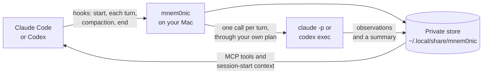

<h1 align="center">
  <br>
  <a href="https://github.com/datashard-ai/mnem0nic">
    <picture>
      <source media="(prefers-color-scheme: dark)" srcset="assets/logo-dark.png">
      <source media="(prefers-color-scheme: light)" srcset="assets/logo-light.png">
      
    </picture>
  </a>
</h1>

<h4 align="center">Persistent memory for <a href="https://claude.com/claude-code">Claude Code</a> and <a href="https://developers.openai.com/codex/cli">Codex</a>. Local, one binary, on the plan you already pay for.</h4>

<p align="center">
  <a href="https://github.com/datashard-ai/mnem0nic/releases/latest"></a>
  
  
  <a href="LICENSE.md"></a>
</p>

<p align="center">
  
</p>

<p align="center">
  <a href="#quick-start">Quick Start</a> •
  <a href="#key-features">Key Features</a> •
  <a href="#moving-from-claude-mem">Moving from claude-mem</a> •
  <a href="#how-it-works">How It Works</a> •
  <a href="#syncing-your-macs">Syncing Your Macs</a> •
  <a href="#mcp-tools">MCP Tools</a> •
  <a href="#privacy">Privacy</a> •
  <a href="#configuration">Configuration</a> •
  <a href="#troubleshooting">Troubleshooting</a>
</p>

<p align="center">
  mnem0nic records your coding sessions on your own Mac, writes a short note after every turn, and gives
  your agent tools to search and pick up past work, across projects and across both CLIs.
</p>

---

## Quick Start

```sh
curl -fsSL https://raw.githubusercontent.com/datashard-ai/mnem0nic/main/install.sh | sh
mnem0nic install
```

Then restart Claude Code or Codex. That's it.

- The first command downloads the latest release, checks its SHA-256 checksum and puts `mnem0nic`
  in `~/.local/bin`.
- The second sets mnem0nic up for all your projects, in each CLI signed in with its own paid plan,
  after a dated backup of each settings file it changes, and downloads the search model (130 MB, once)
  for search by meaning and a small re-ranker (18 MB, once) that puts the best results of a question
  in order.
- **Coming from claude-mem?** `mnem0nic install` finds your claude-mem history and offers to import
  it. Press Enter.

**Requirements:** a Mac with Apple silicon, and at least one of:

- **Claude Code**, signed in with a paid Claude plan (Pro, Max, Team or Enterprise);
- **Codex**, signed in with a paid ChatGPT plan (Plus, Pro, Business, Enterprise or Edu).

## Key Features

- 🧠 **Memory across sessions.** A new session starts with the project's recent context, and your
  agent can look up anything from earlier ones.
- 📝 **A note after every turn.** A small model writes what was done, learned and decided, so search
  finds the point, not just the words.
- 🔍 **Search by words and by meaning,** over notes and the word-for-word conversations.
- ✅ **To-do lists that last.** Open items are shown at the start of every session until they are
  done.
- 🔁 **claude-mem compatible.** The same MCP tools by name, and your claude-mem history imported at
  install.
- 🔄 **Your Macs in step.** Pair your Macs once with a six-digit code, and your memory follows you
  between them on your own network.
- 🔒 **Local.** Everything stays in private folders on your own Macs. No account, no telemetry, no
  server of ours.
- 💳 **Your own subscription.** Notes go through the paid plan you already use: your Claude plan for
  Claude Code, your ChatGPT plan for Codex. Never an API key, so never a per-token bill.
- ⚡ **One native binary.** No Node.js, no Python, nothing left running when you're idle.

## Moving from claude-mem

mnem0nic reads claude-mem's database directly, so your past sessions come with you, and your agent
keeps the same MCP tools by the same names (`mem_search`, `timeline`, `get_observations` and the
rest).

1. **Install, and import in the same step.** `mnem0nic install` finds claude-mem's database where
   claude-mem keeps it, even if you moved claude-mem's data folder, and asks whether to import it.
   Press Enter for yes. Without a terminal to answer it imports without asking; `--no-import` skips
   it. Once it's imported, installing again (an upgrade) doesn't ask again. If you answer no, the
   next install asks again.

2. **If you skipped it, the import stopped, or you kept claude-mem running:**

   ```sh
   mnem0nic import-claude-mem
   ```

   It reads claude-mem's database without changing it, and brings over your observations, session
   summaries, prompts, tool calls and to-do lists, each in the project it belongs to, redacting the
   secrets it recognises. About 35,000 observations took under 10 seconds in our tests. To import a
   copy kept somewhere else: `mnem0nic import-claude-mem --db /path/to/claude-mem.db`.

3. **Turn claude-mem off,** so the two don't both take notes:

   ```sh
   npx claude-mem uninstall
   ```

   This removes claude-mem's hooks and plugin and stops its worker, and keeps your data in
   `~/.claude-mem`. To keep claude-mem installed but off instead:
   `claude plugin disable claude-mem@thedotmack`. Then restart Claude Code.

4. **Search by meaning** comes with install: it downloads the search model once and indexes your
   imported history too. With `--no-model`, `mnem0nic embed` does it later.

The import adds only what is new, so you can keep both for a while, import again, then switch. When
you're happy, delete claude-mem's data with `rm -rf ~/.claude-mem`. Two differences to know: a
session reads only its own project's memory, and results of Datashard's tools are never stored.

## How It Works



1. **Capture.** Hooks at session start, after each turn, before compaction and at session end record
   the conversation: your prompts, the agent's replies, and its tool calls with their input and
   output. Secrets that mnem0nic recognises (API keys, access tokens, private keys, password
   assignments) are redacted before anything is stored.
2. **Notes.** After each turn, a small model writes short notes about it, through the CLI you used and
   its own plan: Claude Haiku through `claude -p` for Claude Code turns, `codex exec` for Codex turns.
   Each CLI is checked for its paid plan at install, at every session start and before every note.
3. **Recall.** A new session starts with recent context for the project. During it, the MCP tools let
   the agent search past sessions, read notes and timelines, and keep to-do lists.

A background process starts when it is needed, writes the notes, holds the embedding model, and exits
after 15 idle minutes. It listens only on `127.0.0.1`, with a private token.

## Syncing Your Macs

Run this on two of your Macs, on the same network:

```sh
mnem0nic pair
```

The first shows a six-digit code; type it on the second. The code never travels over the network,
and a wrong code ends the pairing. From then on, whenever both Macs are on the same network, they sync
in the background.

- **What syncs:** notes, session summaries, prompts, to-do lists, checkpoints, and Claude Code's own
  memory notes for the project. Word-for-word conversations, tool calls and the search index stay on
  the Mac that recorded them. A prompt longer than 200,000 bytes is cut before it is sent.
- **How:** the Macs find each other over Bonjour, prove who they are with the keys they swapped at
  pairing, and sync over an encrypted link. A machine you didn't pair is refused before anything is
  sent.
- **Projects match by their Git remote,** so a repository checked out in different folders on each Mac
  is the same project. A folder outside Git matches by its name.
- **Apart, then together:** both Macs keep working while apart and catch up when they meet. If the same
  Claude Code note was edited on both, the later edit wins, the other stays in its history, and the
  next session start tells you.
- **While you're idle,** macOS keeps the sync port open for mnem0nic and starts it only when your other
  Mac connects.

```sh
mnem0nic devices                    # your paired Macs, and when each was last seen
mnem0nic sync status                # how far behind each one is
mnem0nic sync now                   # sync at once
mnem0nic unpair "Mac name"          # stop syncing with one
mnem0nic notes history NAME         # every version of a Claude Code note
```

## MCP Tools

claude-mem's tools, with the same names and parameters:

| Tool | What it does |
|---|---|
| `mem_search` | Search memory step by step: an index, then context, then the details you pick |
| `save_memory` | Save a note, decision, correction or handoff of your own |
| `search`, `timeline`, `get_observations` | Search with filters, see what happened around a note, read notes by id |
| `get_tool_uses` | Read the original input and output of tool calls already found |
| `work_state_write`, `work_state_read` | Keep to-do lists and working state across sessions |
| `session_start_context` | Show the context a new session starts with |
| `important_workflow` | How to use the tools above, for the agent |

mnem0nic's own tools, over the word-for-word conversations:

| Tool | What it does |
|---|---|
| `memory_search` | Search earlier conversations by words and meaning |
| `memory_get` | Read the messages around a search result |
| `memory_sessions` | List the project's recent sessions |
| `memory_save`, `memory_resume` | Save a checkpoint of your work, and resume from it on the same branch |

## Privacy

- **What stays on your Macs:** everything mnem0nic records, in `~/.local/share/mnem0nic`, readable
  only by your user account. With paired Macs, the records listed under
  [Syncing Your Macs](#syncing-your-macs) go between them, encrypted, and nowhere else.
- **What is sent, and where:** after each turn, its request, its tool calls (long input and output
  trimmed) and the agent's reply go to the provider of the CLI you used: Anthropic for Claude Code,
  OpenAI for Codex. They go through your own login, to the same provider that already handled the
  turn.
- **What is never sent:** the contents of files the agent only read (their paths are sent), images,
  the results of memory tools, and secrets that redaction recognises.
- **Nothing goes to us.** No account, no telemetry, no server of ours.
- **Datashard:** results of Datashard's tools are never stored. Facts are fetched again when needed,
  with your current access.

## Configuration

Settings live in `~/.local/share/mnem0nic/config.toml`:

```toml
[observer]
client = "off"                  # turn the notes off; capture and search keep working
model = "claude-haiku-5-5"      # the model for Claude Code turns
codex_model = "gpt-6-luna"      # the model for Codex turns
parallel = 3                    # note calls at once, from 1 to 8

[search]
semantic_inject = true          # past work on every prompt; off by default
semantic_inject_limit = 5       # how many notes, from 1 to 20
# rerank = false                # uncomment to stop the re-ranker from ordering the best results (on by default)
```

With `semantic_inject` on, every prompt of 20 characters or more reaches Claude with the project's
best-matching notes, as claude-mem's `CLAUDE_MEM_SEMANTIC_INJECT` does, so it sees past work before
it starts. The notes go to Claude Code or Codex with the prompt. It works best with search by
meaning (`mnem0nic embed`); without it, it hands over the notes that share words with the prompt.

When you ask for five results or more with a question of six words or more that holds nothing that
looks like code or a path, a small model (TinyBERT, run by the memory daemon) reads the first ten
results with your question and puts the best match first. A short lookup, a path or an identifier is
never reordered. `rerank = false` (or `off`, `no`, `0`) turns it off, and `MNEM0NIC_RERANK` does the same
for one run; Claude Code sessions that are already open keep the setting they started with, and use a
re-ranker downloaded later only after they restart. Do not put
that line in a `config.toml` that an older mnem0nic also reads: it rejects the key, and cannot look up the
project until the line is removed.

Environment variables take precedence: `MNEM0NIC_OBSERVER_CLIENT`, `MNEM0NIC_OBSERVER_MODEL`,
`MNEM0NIC_OBSERVER_CODEX_MODEL`, `MNEM0NIC_OBSERVER_PARALLEL`, `MNEM0NIC_SEMANTIC_INJECT` and
`MNEM0NIC_SEMANTIC_INJECT_LIMIT` and `MNEM0NIC_RERANK`. `MNEM0NIC_HOME` moves the memory
folder. For the installer, `MNEM0NIC_VERSION=0.2.0` pins a version and `MNEM0NIC_INSTALL_DIR` sets
the folder.

## Commands

| Command | What it does |
|---|---|
| `mnem0nic install [--no-import] [--no-model]` | Set up the hooks and MCP server, download the search model and the re-ranker (`--no-model` skips both), and offer to import claude-mem's history |
| `mnem0nic uninstall [--purge]` | Remove them; `--purge` also deletes your memory |
| `mnem0nic search "words"` | Search this project's sessions from the terminal |
| `mnem0nic sessions` | List this project's recent sessions |
| `mnem0nic embed` | Download the search model and the re-ranker if install didn't, and index what is new |
| `mnem0nic import-claude-mem` | Import your claude-mem history |
| `mnem0nic daemon status` | Show the background process |
| `mnem0nic pair` | Pair this Mac with another of yours, with a six-digit code |
| `mnem0nic devices`, `mnem0nic unpair NAME` | List your paired Macs; stop syncing with one |
| `mnem0nic sync status`, `mnem0nic sync now` | See how sync is doing; sync at once |
| `mnem0nic project merge OLD NEW` | Read a project's older memory as part of another |

`mnem0nic help` lists every command.

## Upgrade and Uninstall

Upgrade by running the install command again, then `mnem0nic install`, then restart Claude Code or
Codex: a session keeps the mnem0nic MCP server it started with until you restart it. Your memory,
settings and pairings are kept.

```sh
mnem0nic uninstall            # removes the hooks and MCP server, keeps your memory
mnem0nic uninstall --purge    # also deletes ~/.local/share/mnem0nic
rm ~/.local/bin/mnem0nic
```

## Troubleshooting

- **"mnem0nic is off in this session"** at the start of a session: that CLI isn't signed in with a paid
  plan of its own. The message says what to do; then start a new session.
- **`command not found: mnem0nic`:** `~/.local/bin` isn't on your `PATH`. Add it with
  `echo 'export PATH="$HOME/.local/bin:$PATH"' >> ~/.zshrc`, then open a new terminal.
- **macOS blocks the program** after a download from the releases page in a browser: use the install
  command, or run `xattr -d com.apple.quarantine ~/.local/bin/mnem0nic` once.
- **Notes don't appear:** check `mnem0nic daemon status`, and that `claude` or `codex` runs in your
  terminal.
- **Your Macs don't sync:** they must be on the same network, and some guest or office networks block
  the Bonjour messages they find each other with. `mnem0nic sync status` shows when each was last
  seen. macOS may ask once whether mnem0nic may use the local network: allow it.

## Support

Report bugs and ask questions in [Issues](https://github.com/datashard-ai/mnem0nic/issues). Report
security problems privately, as [SECURITY.md](SECURITY.md) describes. Release notes are in
[CHANGELOG.md](CHANGELOG.md).

## Licence

mnem0nic is proprietary software. © 2026 Xibit Digital. All rights reserved. Use is subject to
[LICENSE.md](LICENSE.md). It includes open-source components, listed with their licences in
[THIRD-PARTY-NOTICES.md](THIRD-PARTY-NOTICES.md).

<p align="center"><sub>mnem0nic, by Xibit Digital · <a href="https://datashard.ai/mnem0nic">datashard.ai/mnem0nic</a></sub></p>
